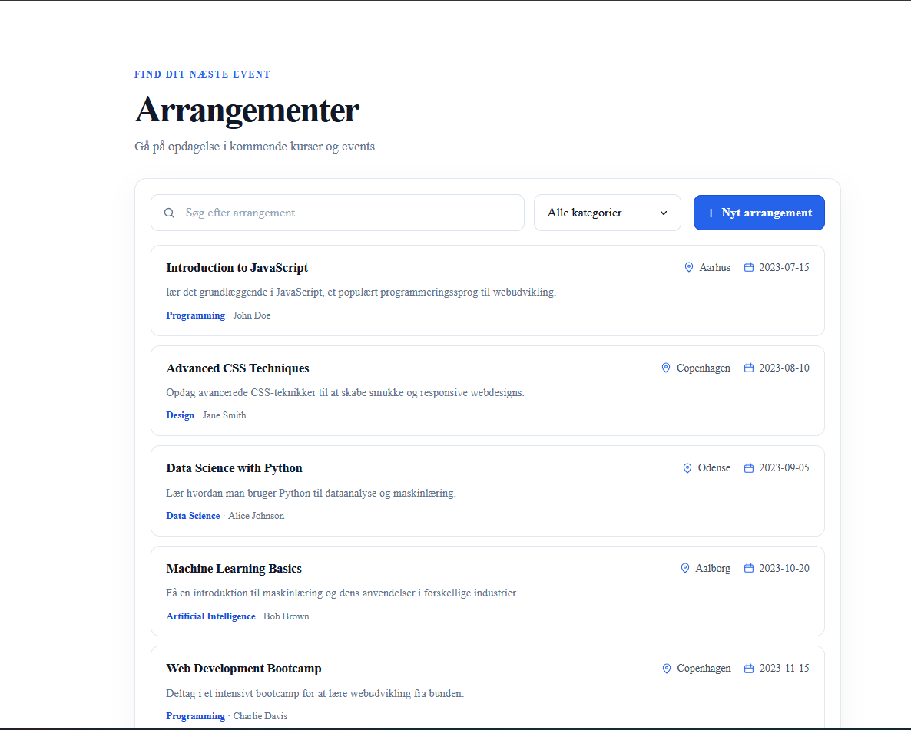
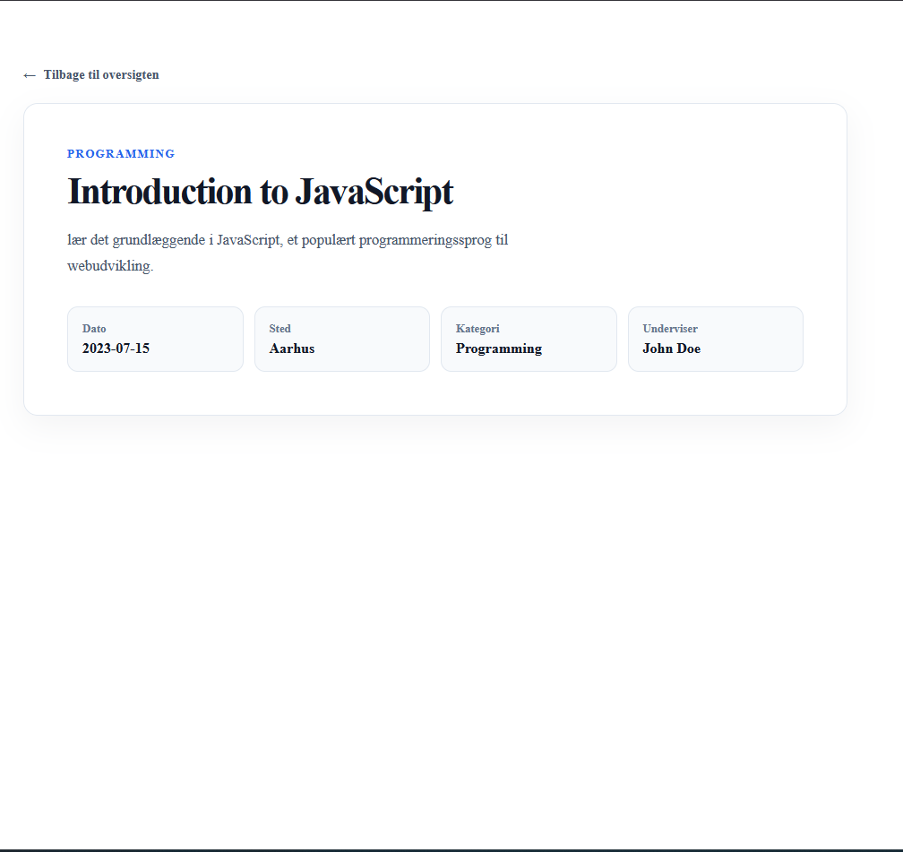

# Arrangementer

En Vue-applikation til at finde og se detaljer om arrangementer. Applikationen er bygget med Vue 3, Vite og Vue Router. Kildekoden findes i `src/`.

## Kom i gang

Kræver Node.js `^22.18.0` eller `>=24.12.0`.

```sh
npm install
npm run dev
```

Åbn den lokale adresse, som Vite viser i terminalen. Produktionsversionen kan bygges med `npm run build`.

## Skærmbilleder

**Oversigten**



**Detaljesiden**



## Vue-komponenter

- **`EventsView.vue`** samler oversigtssiden. Den henter og viser arrangementer, holder styr på indlæsning og fejl, og forbinder søgning, kategorifilter og sidetal med listen.
- **`SearchFilter.vue`** viser søgefelt og kategorivælger. Den beregner en filtreret liste ud fra arrangementernes titel, sted og kategori og sender resultatet tilbage til oversigten.

Derudover viser **`EventList.vue`** listen med arrangementer, og **`EventCard.vue`** viser hvert arrangement som et link til dets detaljeside.

## Reaktiv søgning og filtrering

Oversigtssiden gemmer søgeteksten (`searchQuery`), den valgte kategori (`kategorierQuery`) og arrangementerne i Vue `ref`-værdier. `SearchFilter.vue` bruger `v-model` til at synkronisere søgefelt og kategorivælger med oversigtssiden. En `computed`-værdi filtrerer listen, når søgningen eller kategorien ændres: søgeteksten sammenlignes uden forskel på store og små bogstaver med arrangementets titel og sted, og et valgt kategori-filter begrænser resultatet yderligere. Listen opdateres automatisk, fordi Vue holder øje med de reaktive værdier. Filtrering gælder de arrangementer, der er indlæst på den aktuelle side.

## Navigation med Vue Router

Routeren i `src/router/index.js` bruger browserens historik til at vise den rigtige side uden fuld genindlæsning:

- `/` viser arrangementsoversigten.
- `/events/:id` viser detaljerne for arrangementet med det angivne id.

`EventCard.vue` bruger `RouterLink` til at åbne detaljesiden. Detaljesiden bruger `useRoute()` til at læse id'et fra adressen og tilbyder et `RouterLink` tilbage til oversigten.

## Data og HTTP-kald

`src/dataSource.js` indeholder indstillingen `USE_DUMMY_DATA`, som som standard er `true`. Derfor bruger appen lokale testdata fra `src/data/events.js`, og der foretages ikke HTTP-kald i standardopsætningen.

Hvis `USE_DUMMY_DATA` sættes til `false`, henter oversigten arrangementer fra JSONPlaceholder med `fetch` og paginering (`_limit` og `_page`). Den læser også `X-Total-Count` for at beregne antal sider og tilpasser API'ets indlæg til applikationens arrangementsformat. På detaljesiden hentes det valgte arrangement fra `/posts/:id`.

Under indlæsning vises en statusbesked, og oversigtens kontroller skjules. Hvis et kald fejler, svaret har en fejlstatus, eller dataene ikke har det forventede format, vises en fejlbesked og en **Prøv igen**-knap. Fejl logges også i konsollen. Hvis et gyldigt opslag ikke findes, vises i stedet en besked om, at arrangementet ikke blev fundet, med et link tilbage til oversigten.
